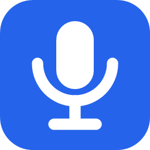
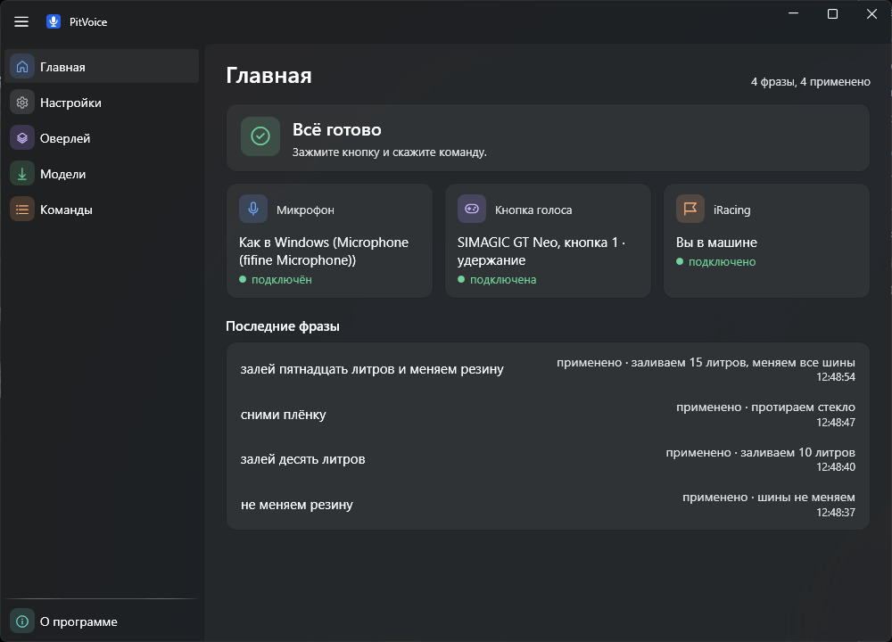
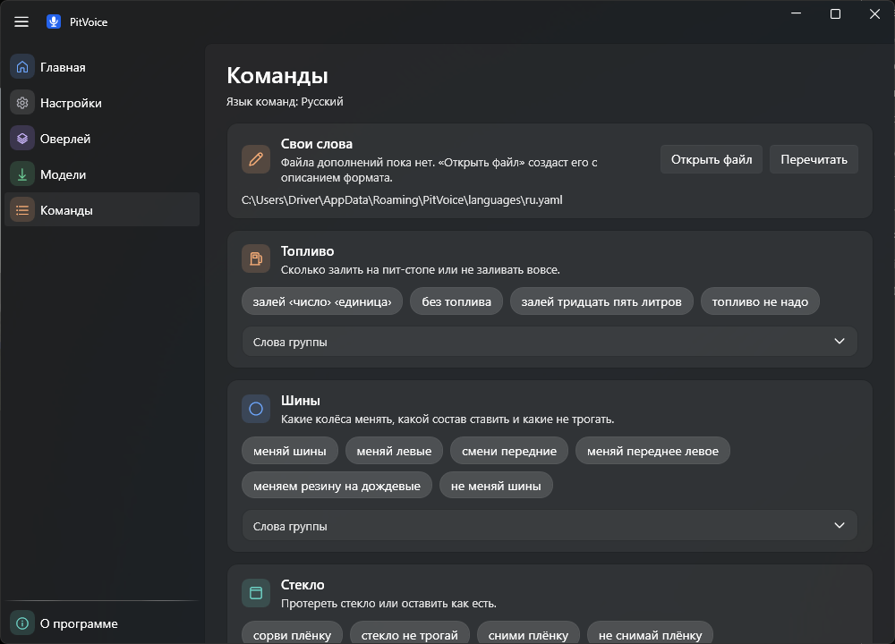

  

<h1 align="center">PitVoice</h1>

  <strong>Голосовые пит-команды для iRacing.</strong> Зажмите кнопку на руле, скажите «меняй шины и залей тридцать
  литров» — PitVoice выставит пит-стоп в игре, а короткий звук подтвердит результат. Бесплатно, с открытым кодом,
  для Windows.

  
  
  
  

  <a href="https://github.com/attellians/PitVoice/releases/latest"><b>Скачать</b></a>
  ·
  <a href="#возможности">Возможности</a>
  ·
  <a href="#что-можно-сказать">Команды</a>
  ·
  <a href="#вопросы-и-ответы">Вопросы и ответы</a>
  ·
  <a href="https://github.com/attellians/PitVoice/issues">Сообщить об ошибке</a>
  ·
  <a href="README.en.md">English</a>

> [!WARNING]
> Официальные сборки — только на странице [Releases](https://github.com/attellians/PitVoice/releases) этого
> репозитория.

  

## Зачем

Чтобы выставить пит-стоп в iRacing, приходится отвлекаться на чёрный ящик или клавиатуру прямо на трассе. С PitVoice
достаточно нажать кнопку на руле и сказать, что сделать на пит-стопе. Речь распознаётся на вашем компьютере без
интернета, команды уходят в игру через официальный iRacing SDK, а приложение проверяет по телеметрии, что игра их
приняла.

## Возможности

- **Кнопка на руле или клавиша.** Любая кнопка игрового устройства (руль, кнопочная панель) или клавиша клавиатуры.
  Два режима: «удержание» (держите, говорите, отпускаете) и «рация» (нажали — говорите — нажали ещё раз).
- **Русский и английский.** Язык команд и язык интерфейса выбираются отдельно.
- **Распознавание без интернета.** Модель речи (Vosk) скачивается один раз по вашей кнопке и работает локально.
  Никакой телеметрии и облака.
- **Несколько команд одной фразой.** «Залей десять литров, меняй правую сторону и сорви плёнку». Фраза исполняется
  целиком или не исполняется вовсе.
- **Проверка по телеметрии.** «Успех» звучит, только когда игра действительно приняла команды. Если вы не в машине,
  нет связи с игрой или что-то не применилось, звучит «ошибка».
- **Три коротких звука** вместо голоса: начало записи, успех, ошибка.
- **Индикатор поверх игры.** Маленький значок в машине показывает «слушаю», «распознаю» и итог фразы. Клики проходят
  сквозь него в игру. Вид, размер, прозрачность и место настраиваются в разделе «Оверлей».
- **Свои слова.** К командам можно добавить свои глаголы и названия — раздел «Команды» покажет, что получилось.
- **Последние фразы** на главной странице: что услышано, чем закончилось и почему.
- **Работает в трее**, без прав администратора и без вмешательства в процесс игры.

## Что можно сказать

Порядок слов свободный, после «и» действие можно не повторять. Полный список слов — в разделе «Команды» приложения.

| Что сделать | Например |
|---|---|
| Топливо | «залей тридцать пять литров», «долей двадцать», «залить двадцать», «без топлива» |
| Все шины | «меняй шины», «поменяй резину», «свежую резину» |
| Часть шин | «меняй левые», «смени передние», «меняй переднее правое и задние», «правые не меняй» |
| Без шин | «не меняй шины», «без шин» |
| Состав шин | «меняй шины на сухие», «замена на сухие», «на слики», «меняем резину на дождевые» |
| Стекло | «сорви плёнку», «почистить стекло» |
| Быстрый ремонт | «быстрый ремонт», «без ремонта» |
| Сбросить всё | «сбрось всё», «отмени всё», «снимай всё» |
| Вместе | «меняй шины и залей двадцать пять литров» |

По-английски: «add thirty liters», «change left side and fronts», «change to wet tires», «tear off», «fast repair»,
«clear all».

  

## Установка

| Что нужно | |
|---|---|
| Система | Windows 10 или 11, 64 бит |
| Игра | iRacing; для индикатора — оконный или borderless-режим |
| Микрофон | любой, гарнитура лучше |
| Место | ~90 МБ установщик и ~45 МБ модель речи языка |

1. Скачайте `PitVoice-win-Setup.exe` со страницы [последнего релиза](https://github.com/attellians/PitVoice/releases/latest)
   и запустите. Установка идёт в ваш профиль (`%LocalAppData%\PitVoiceApp`), права администратора не нужны, ярлыки
   появятся в меню «Пуск» и на рабочем столе.
2. Откройте раздел **«Модели»** и скачайте модель речи своего языка. Это единственное, что PitVoice скачивает из
   интернета, и только по вашей кнопке.
3. В **«Настройках»** нажмите **«Назначить кнопку»**, затем кнопку на руле.
4. Сядьте в машину в iRacing, зажмите кнопку и скажите команду. Что услышано и чем закончилось, видно на главной
   странице.

> [!IMPORTANT]
> **Установщик пока не подписан**, поэтому Windows SmartScreen может показать «Система Windows защитила ваш
> компьютер». Нажмите **Подробнее**, затем **Выполнить в любом случае**.

**Новая версия.** Приложение само обновления не ищет и в сеть не ходит. Скачайте установщик новой версии со страницы
[релизов](https://github.com/attellians/PitVoice/releases) и запустите. Он скажет, что PitVoice уже установлен, —
нажмите **Repair**. Настройки, модели и свои слова сохранятся.

**Альфа-версии.** Промежуточные сборки выходят как пре-релизы `PitVoice X.Y.Z-alpha` и ставятся так же, поверх
обычной версии. Вернуться можно установщиком стабильной версии.

**Удаление.** «Параметры → Приложения → Установленные приложения → PitVoice → Удалить» удаляет программу и все её
данные: модели, логи, диагностику, настройки и свои слова.

## Вопросы и ответы

<b>Не забанят ли меня?</b>

 
PitVoice не внедряется в игру и не меняет её файлы. Состояние игры он читает через официальный iRacing SDK, а
пит-команды отправляет сообщениями того же SDK, которые для этого и предназначены. Это то же самое, что выставить
пит-стоп в игре вручную.

<b>Нужен ли интернет? Что PitVoice отправляет в сеть?</b>

 
Интернет нужен только чтобы скачать модель речи — по вашей кнопке в разделе «Модели». Больше PitVoice никуда не
обращается: ни телеметрии, ни аналитики, ни проверки обновлений. Голос не сохраняется на диск, а распознанные фразы не
пишутся в лог.

<b>Команды не доходят до игры или кнопка не работает в игре</b>

 
Скорее всего, iRacing запущен от имени администратора, а PitVoice — нет. Тогда Windows блокирует сообщения в игру и
нажатия клавиш в её окне. Запускайте оба обычным способом. Кнопка руля надёжнее клавиши клавиатуры.

<b>PitVoice меня плохо понимает</b>

 
Говорите после звука начала записи и отпускайте кнопку, договорив. На главной странице видно, что именно услышано. Если
вы называете команду по-своему, добавьте свои слова: раздел «Команды» → «Открыть файл». Если фраза отклонена, PitVoice
ничего не отправляет в игру: лучше переспросить, чем угадать.

<b>Не вижу индикатор поверх игры</b>

 
Индикатор показывается только когда вы в машине. В эксклюзивном полноэкранном режиме Windows не показывает окна
поверх игры — переключите iRacing в borderless или оконный режим. Выключить или переместить индикатор можно в разделе
«Оверлей» или пунктом «Переместить индикатор» в меню значка в трее.

<b>Где PitVoice хранит данные?</b>

 
Программа — <code>%LocalAppData%\PitVoiceApp</code>; модели, логи и архивы диагностики — <code>%LocalAppData%\PitVoice</code>;
настройки и свои слова — <code>%AppData%\PitVoice</code>.

<b>Почему в установщике есть файлы под GPL?</b>

 
Распознаватель Vosk для Windows собран MinGW-w64 и приходит с <code>libstdc++-6.dll</code> и <code>libgcc_s_seh-1.dll</code>.
Они под GPL-3.0 с исключением GCC Runtime Library Exception, которое разрешает поставлять их с программами под любой
лицензией. Сам PitVoice — под MIT. Все компоненты и лицензии — в <a href="THIRD-PARTY-NOTICES.md">THIRD-PARTY-NOTICES.md</a>.

## Обратная связь

Нашли ошибку или есть идея — откройте [issue](https://github.com/attellians/PitVoice/issues). Если приложение упало,
приложите архив диагностики: «Настройки» → «Собрать диагностику».

Сборка из исходников и всё для разработчиков — [docs/development.md](docs/development.md), как добавить язык —
[docs/adding-a-language.md](docs/adding-a-language.md).

## Лицензия

[MIT](LICENSE). Сторонние компоненты: [THIRD-PARTY-NOTICES.md](THIRD-PARTY-NOTICES.md).

PitVoice не связан с iRacing.com Motorsport Simulations. iRacing — товарный знак своего владельца.
